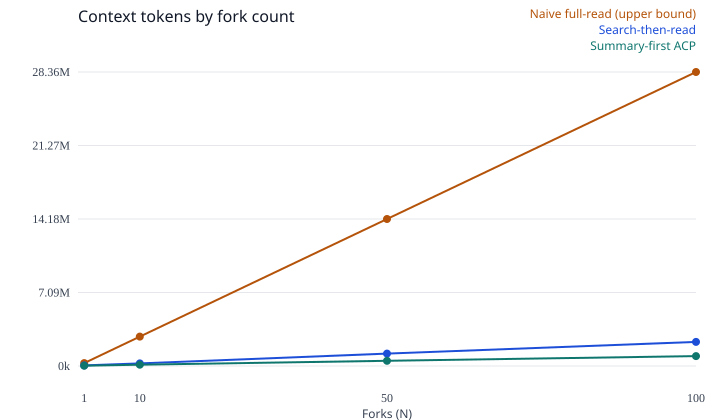
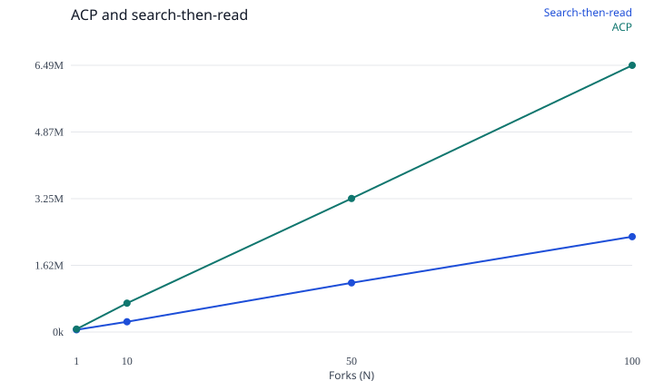

# Daytona ACP offline benchmark

Tokenizer: `cl100k_base` (tiktoken 1.0.22), counted with `computeTokenCounts` from `@atomic-content-protocol/core`.

Policy: `mcp-find-similar-top3`. ACP sends `list_acos` frontmatter for all 54 objects, `find_similar` content-overlap, and `read_aco` for the top 3 hits. Search-then-read runs Okapi BM25 (k1=1.2, b=0.75) over the raw title plus body, then sends the title and URL index, the top 3 ranking, and those full pages. Naive full-read sends every cached page body. It is an upper bound, not what a careful agent does. The question bank has 15 questions. Fork counts above that cycle the bank (`question i % 15`).

Prices used for the dollar columns are `MODEL_PRICING["claude-haiku-4-5"]` input at $1 per million tokens. Output tokens are not included, because this run does not call a model. These are not invoices.

A positive "ACP vs search" percent means ACP used fewer input tokens than search-then-read. A negative percent means ACP used more. Savings against the naive full-read are an upper bound.

The repository README's 86% illustration (250,000 tokens down to 35,000 on 50 documents) is a different hypothetical. It is not this measurement.

## Per question

| Question | Naive tokens | Search tokens | ACP tokens | Search opened | ACP opened | Search hit | ACP hit | Search answer | ACP answer |
|---|---:|---:|---:|---|---|---|---|---|---|
| d01 | 283,650 | 54,270 | 71,081 | linux-sandboxes, sandboxes, windows-sandboxes | windows-sandboxes, macos-sandboxes, snapshots | yes | no | yes | no |
| d02 | 283,642 | 20,745 | 76,648 | persistence, troubleshooting, billing | linux-sandboxes, windows-sandboxes, macos-sandboxes | no | no | no | no |
| d03 | 283,648 | 19,104 | 81,525 | volumes, persistence, isolation | volumes, computer-use, scale | yes | yes | yes | yes |
| d04 | 283,649 | 27,649 | 64,515 | troubleshooting, network-limits, isolation | troubleshooting, organizations, warm-pools | yes | no | yes | no |
| d05 | 283,650 | 40,109 | 61,768 | vpn-connections, authentication, mount-external-storage | file-system-operations, authentication, observability-otel-collection | yes | yes | yes | yes |
| d06 | 283,640 | 6,226 | 80,960 | macos-sandboxes, vnc-access, playground | process-code-execution, computer-use, git-operations | no | yes | no | yes |
| d07 | 283,645 | 21,264 | 68,318 | declarative-builder, snapshots, architecture | declarative-builder, git-operations, file-system-operations | yes | yes | yes | yes |
| d08 | 283,650 | 17,492 | 67,088 | troubleshooting, typescript-sdk, warm-pools | macos-sandboxes, linux-sandboxes, warm-pools | yes | yes | yes | yes |
| d09 | 283,638 | 23,832 | 67,223 | vpn-connections, git-operations, isolation | macos-sandboxes, linux-sandboxes, api-keys | no | no | no | yes |
| d10 | 283,641 | 18,923 | 62,226 | secrets, isolation, tools-api | git-operations, file-system-operations, macos-sandboxes | yes | no | yes | no |
| d11 | 283,647 | 9,114 | 51,222 | webhooks, limits, acceptable-use | webhooks, limits, linked-accounts | yes | yes | yes | yes |
| d12 | 283,638 | 39,216 | 48,806 | typescript-sdk, mount-external-storage, network-limits | typescript-sdk, go-sdk, agent-skills | yes | yes | yes | yes |
| d13 | 283,646 | 14,183 | 53,866 | preview, isolation, tools-api | preview, isolation, regions | yes | yes | yes | yes |
| d14 | 283,643 | 19,540 | 60,492 | log-streaming, process-code-execution, declarative-builder | log-streaming, process-code-execution, audit-logs | yes | yes | yes | yes |
| d15 | 283,645 | 13,580 | 49,347 | regions, scale, acceptable-use | regions, python-sdk, macos-sandboxes | yes | yes | yes | yes |

## Fork scaling

Assembly time is local tokenization time, summed across the N assignments (a repeated question adds its measured time again). It is not sandbox boot time and not model latency. Naive answer support is the expected string inside the full page text. Search answer support is the string inside the search prompt material. ACP answer support is the string inside the metadata catalog plus opened bodies. Retrieval hit means every gold page was opened. None of these is a model grade.

| N | Naive tokens | Search tokens | ACP tokens | ACP vs naive | ACP vs search | Naive $ | Search $ | ACP $ | Naive answer | Search hit | Search answer | ACP hit | ACP answer |
|---:|---:|---:|---:|---:|---:|---:|---:|---:|---:|---:|---:|---:|---:|
| 1 | 283,650 | 54,270 | 71,081 | 74.9% | -31.0% | $0.2837 | $0.0543 | $0.0711 | 100.0% | 100.0% | 100.0% | 0.0% | 0.0% |
| 10 | 2,836,453 | 249,614 | 701,352 | 75.3% | -181.0% | $2.8365 | $0.2496 | $0.7014 | 100.0% | 70.0% | 70.0% | 50.0% | 60.0% |
| 50 | 14,182,255 | 1,197,618 | 3,250,792 | 77.1% | -171.4% | $14.1823 | $1.1976 | $3.2508 | 100.0% | 80.0% | 80.0% | 64.0% | 70.0% |
| 100 | 28,364,485 | 2,321,096 | 6,491,862 | 77.1% | -179.7% | $28.3645 | $2.3211 | $6.4919 | 100.0% | 79.0% | 79.0% | 65.0% | 72.0% |

The first chart uses the naive upper bound as its scale, so the other two lines sit near the bottom. The second chart is only search-then-read and ACP.

## Enrichment, counted once

Committed ACO metadata is extractive (the first sentences of each Daytona doc, heading tags, and backtick identifiers). No model was called, so measured model spend for this corpus is $0. The figures below are the size of the real UnifiedPipeline prompt plus the package's estimated output, priced with MODEL_PRICING. They are not an invoice. buildUnifiedPrompt truncates each body to 4000 characters, which is what that prompt builder sends. A job that uploaded every full page would be larger. Break-even against the naive full-read is an upper bound. Break-even against search-then-read is the realistic comparison. Null means ACP did not accumulate a token or dollar saving against that arm within 100,000 forks.

| Item | Value |
|---|---|
| Measured UnifiedPipeline prompt input tokens (cl100k) | 54,630 |
| Estimated output tokens | 16,200 |
| Estimated output source | estimateEnrichmentCost(..., "standard") outputTokens constant, not a completion |
| Package `estimateEnrichmentCost` total (approximate tokenizer) | $0.1516 |
| Modeled fast-tier USD (measured input + estimated output) | $0.1356 |
| Break-even vs naive full-read, measured tokens | 1 fork |
| Break-even vs naive full-read, modeled USD | 1 fork |
| Break-even vs search-then-read, measured tokens | not reached within 100,000 forks |
| Break-even vs search-then-read, modeled USD | not reached within 100,000 forks |
| Model spend that produced the committed metadata | $0 |

A break-even of 0 forks means the measured per-fork token saving already exceeds the one-time prompt, or the cost being compared is zero.

## Accuracy

Retrieval hit means every gold page for that question was one of the opened objects. Answer support means the expected answer string occurs in that arm's context. This is not a model grade. A live model can still answer wrongly from a context that contains the string.

## Caveats

- Naive full-read is an upper bound. It stuffs every page into one prompt. Search-then-read is the realistic baseline: BM25 over raw text, top 3, same k as ACP.
- The ACP prompt still includes the full metadata catalog plus three opened objects. That catalog can cost more tokens than a title and URL index plus three raw pages.
- Page bodies for the Wikipedia corpus are MediaWiki plaintext extracts, capped at 100,000 characters. `fetchPageForUrl` on those HTML pages returns chrome and wikitext, which is recorded on the manifest and is not the body. The docs demo uses the markdown files from the docs index instead.
- Metadata was not produced by `UnifiedPipeline`. A model summary could be shorter or longer, and could rank differently.
- Cycling the question bank out to N=100 repeats the same work. It shows the fork curve, not that many distinct questions.
- Input-only dollar savings ignore output tokens. Similar answer lengths on both sides would add about the same output cost to each and would not remove the input gap.
- Naive prompts for the Wikipedia corpus are larger than a typical 200k-token context window. The live harness uses search-then-read by default so the comparison call can fit. Set `ACP_LIVE_BASELINE=naive` or `both` to also send the upper bound.
