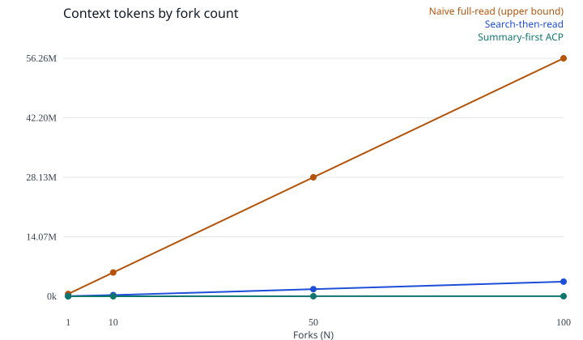
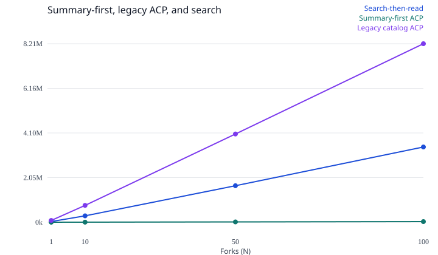

# Daytona ACP offline benchmark

Tokenizer: `cl100k_base` (tiktoken 1.0.22), counted with `computeTokenCounts` from `@atomic-content-protocol/core`.

Headline policy: `summary-first`. BM25 (k1=1.2, b=0.75) ranks title, summary, and tags only, and keeps the top 3. The prompt contains those compact summaries (slug, title, summary) and a decision line. A candidate covers the question when at least max(1, ceil(unique query terms * 0.5)) of those terms appear in its title, summary, or tags. If any candidate covers, no body is opened. Otherwise up to 3 full markdown bodies are opened. On this question bank, 20 of 20 questions were answered from summaries and opened no body. Summary-first tokens are the sum of two separate cl100k encodings: the decision prompt (instruction, question, summaries, and the decision line) plus the opened markdown. They are not one concatenated encoding, and the decision line is the policy string, not a model completion.

Variant `mcp-find-similar-top3` still puts `list_acos` frontmatter for all 50 objects in the prompt, plus `find_similar` content-overlap and `read_aco` JSON for the top 3. That variant is reported so the catalog cost stays visible.

Search-then-read runs the same BM25 settings over the raw title plus body, then sends the title and URL index, the top 3 ranking, and those full pages. Naive full-read sends every cached page body. It is an upper bound, not what a careful agent does. The question bank has 20 questions. Fork counts above that cycle the bank (`question i % 20`).

Prices used for the dollar columns are `MODEL_PRICING["claude-haiku-4-5"]` input at $1 per million tokens, applied to the measured cl100k totals. Output tokens are not included, because this run does not call a model. The decision line is priced as input, because it is text in the decision prompt. These are not invoices.

A positive "summary-first vs search" percent means summary-first used fewer input tokens than search-then-read. A negative percent means it used more. The same reading applies to the legacy column. Savings against the naive full-read are an upper bound.

The repository README's 86% illustration (250,000 tokens down to 35,000 on 50 documents) is a different hypothetical. It is not this measurement.

## Per question tokens

| Question | Naive | Search | Summary decision | Summary bodies | Summary-first | Legacy ACP |
|---|---:|---:|---:|---:|---:|---:|
| q01 | 562,635 | 31,602 | 285 | 0 | 285 | 81,874 |
| q02 | 562,634 | 34,612 | 293 | 0 | 293 | 81,796 |
| q03 | 562,631 | 38,900 | 251 | 0 | 251 | 76,943 |
| q04 | 562,634 | 37,560 | 301 | 0 | 301 | 65,121 |
| q05 | 562,631 | 26,620 | 301 | 0 | 301 | 69,969 |
| q06 | 562,628 | 18,603 | 275 | 0 | 275 | 81,650 |
| q07 | 562,628 | 24,060 | 229 | 0 | 229 | 71,988 |
| q08 | 562,634 | 25,567 | 266 | 0 | 266 | 71,995 |
| q09 | 562,633 | 36,592 | 293 | 0 | 293 | 88,922 |
| q10 | 562,635 | 19,383 | 222 | 0 | 222 | 83,217 |
| q11 | 562,637 | 28,744 | 318 | 0 | 318 | 96,717 |
| q12 | 562,636 | 49,990 | 286 | 0 | 286 | 84,804 |
| q13 | 562,637 | 35,504 | 259 | 0 | 259 | 93,751 |
| q14 | 562,636 | 32,905 | 277 | 0 | 277 | 82,800 |
| q15 | 562,640 | 32,202 | 253 | 0 | 253 | 84,308 |
| q16 | 562,634 | 41,543 | 311 | 0 | 311 | 82,059 |
| q17 | 562,629 | 30,151 | 319 | 0 | 319 | 81,339 |
| q18 | 562,633 | 51,542 | 275 | 0 | 275 | 89,550 |
| q19 | 562,629 | 51,538 | 271 | 0 | 271 | 95,152 |
| q20 | 562,630 | 44,135 | 320 | 0 | 320 | 78,042 |

## Per question retrieval

Summary-first hit means every gold slug is in the top-3 summary candidates. It does not mean the body was opened. Search hit and legacy hit mean every gold slug was opened. Answer support means the expected string is in that arm's shown context: search material, summary-first summaries plus opened markdown (not the question), or the legacy catalog plus opened JSON bodies. None of these is a model grade.

| Question | Search opened | Summary candidates | Decision | Summary bodies | Legacy opened | Search hit | Summary hit | Legacy hit | Search answer | Summary answer | Legacy answer |
|---|---|---|---|---|---|---|---|---|---|---|---|
| q01 | alan-turing, public-key-cryptography, rsa | alan-turing, printing-press, ada-lovelace | answer | (none) | alan-turing, printing-press, ada-lovelace | yes | yes | yes | yes | yes | yes |
| q02 | ada-lovelace, alan-turing, turing-machine | ada-lovelace, voyager-1, tcp | answer | (none) | ada-lovelace, tcp, voyager-1 | yes | yes | yes | yes | yes | yes |
| q03 | grace-hopper, apollo-11, antikythera | grace-hopper, tim-berners-lee, quicksort | answer | (none) | grace-hopper, tim-berners-lee, quicksort | yes | yes | yes | yes | yes | yes |
| q04 | margaret-hamilton, apollo-11, james-webb | margaret-hamilton, apollo-11, go-game | answer | (none) | margaret-hamilton, linus-torvalds, postgresql | yes | yes | yes | yes | yes | yes |
| q05 | tim-berners-lee, postgresql, antikythera | tim-berners-lee, rsa, sahara | answer | (none) | tim-berners-lee, sahara, mariana-trench | yes | yes | yes | yes | yes | yes |
| q06 | linus-torvalds, rust, kubernetes | linus-torvalds, tcp, chess | answer | (none) | linus-torvalds, antikythera, tcp | yes | yes | yes | yes | yes | yes |
| q07 | python, rust, grace-hopper | python, rust, library-of-alexandria | answer | (none) | python, rust, grace-hopper | yes | yes | yes | yes | yes | yes |
| q08 | rust, python, postgresql | rust, python, haiku | answer | (none) | rust, python, grace-hopper | yes | yes | yes | yes | yes | yes |
| q09 | postgresql, hubble, python | postgresql, rsa, olympic-games | answer | (none) | postgresql, rsa, olympic-games | yes | yes | yes | yes | yes | yes |
| q10 | kubernetes, postgresql, linus-torvalds | kubernetes, turing-machine, quicksort | answer | (none) | kubernetes, quicksort, turing-machine | yes | yes | yes | yes | yes | yes |
| q11 | tcp, rust, public-key-cryptography | tcp, kyoto-protocol, periodic-table | answer | (none) | tcp, periodic-table, kyoto-protocol | yes | yes | yes | yes | yes | yes |
| q12 | quicksort, alan-turing, pi | quicksort, tim-berners-lee, alan-turing | answer | (none) | quicksort, alan-turing, tim-berners-lee | yes | yes | yes | yes | yes | yes |
| q13 | turing-machine, ada-lovelace, go-game | turing-machine, periodic-table, pi | answer | (none) | turing-machine, periodic-table, antikythera | yes | yes | yes | yes | yes | yes |
| q14 | public-key-cryptography, rsa, tcp | public-key-cryptography, rsa, postgresql | answer | (none) | public-key-cryptography, rsa, tcp | yes | yes | yes | yes | yes | yes |
| q15 | rsa, public-key-cryptography, quicksort | rsa, public-key-cryptography, sourdough | answer | (none) | rsa, public-key-cryptography, quicksort | yes | yes | yes | yes | yes | yes |
| q16 | voyager-1, hubble, james-webb | voyager-1, hubble, perseverance | answer | (none) | voyager-1, hubble, perseverance | yes | yes | yes | yes | yes | yes |
| q17 | apollo-11, perseverance, margaret-hamilton | apollo-11, perseverance, voyager-1 | answer | (none) | apollo-11, perseverance, voyager-1 | yes | yes | yes | yes | yes | yes |
| q18 | hubble, james-webb, apollo-11 | hubble, james-webb, voyager-1 | answer | (none) | hubble, voyager-1, james-webb | yes | yes | yes | yes | yes | yes |
| q19 | james-webb, hubble, apollo-11 | james-webb, hubble, voyager-1 | answer | (none) | james-webb, hubble, antikythera | yes | yes | yes | yes | yes | yes |
| q20 | perseverance, apollo-11, hubble | perseverance, apollo-11, voyager-1 | answer | (none) | perseverance, apollo-11, margaret-hamilton | yes | yes | yes | yes | yes | yes |

## Fork scaling

Assembly time in the JSON is local tokenization time, summed across the N assignments. It is not sandbox boot time and not model latency.

| N | Naive tokens | Search tokens | Summary-first tokens | Legacy tokens | Summary vs naive | Summary vs search | Legacy vs search | Naive $ | Search $ | Summary $ | Legacy $ |
|---:|---:|---:|---:|---:|---:|---:|---:|---:|---:|---:|---:|
| 1 | 562,635 | 31,602 | 285 | 81,874 | 99.9% | 99.1% | -159.1% | $0.5626 | $0.0316 | $0.0003 | $0.0819 |
| 10 | 5,626,323 | 293,499 | 2,716 | 773,475 | 100.0% | 99.1% | -163.5% | $5.6263 | $0.2935 | $0.0027 | $0.7735 |
| 50 | 28,131,651 | 1,677,005 | 13,926 | 4,057,469 | 100.0% | 99.2% | -141.9% | $28.1317 | $1.6770 | $0.0139 | $4.0575 |
| 100 | 56,263,320 | 3,458,765 | 28,025 | 8,209,985 | 100.0% | 99.2% | -137.4% | $56.2633 | $3.4588 | $0.0280 | $8.2100 |

| N | Search hit | Summary hit | Legacy hit | Naive answer | Search answer | Summary answer | Legacy answer |
|---:|---:|---:|---:|---:|---:|---:|---:|
| 1 | 100.0% | 100.0% | 100.0% | 100.0% | 100.0% | 100.0% | 100.0% |
| 10 | 100.0% | 100.0% | 100.0% | 100.0% | 100.0% | 100.0% | 100.0% |
| 50 | 100.0% | 100.0% | 100.0% | 100.0% | 100.0% | 100.0% | 100.0% |
| 100 | 100.0% | 100.0% | 100.0% | 100.0% | 100.0% | 100.0% | 100.0% |

The first chart uses the naive upper bound as its scale, so the other lines sit near the bottom. The second chart is search-then-read, summary-first, and the legacy catalog policy.

## Enrichment, counted once

Committed ACO metadata is extractive (Wikipedia lead, MediaWiki categories, a proper-noun scan). No model was called, so measured model spend for this corpus is $0. The figures below are the size of the real UnifiedPipeline prompt plus the package's estimated output, priced with MODEL_PRICING. They are not an invoice. buildUnifiedPrompt truncates each body to 4000 characters, which is what that prompt builder sends. A job that uploaded every full page would be larger. Break-even for the headline summary-first policy is against the naive full-read (an upper bound) and against search-then-read. The legacy catalog policy has its own break-even rows. Null means that policy did not accumulate a token saving against that arm within 100,000 forks.

| Item | Value |
|---|---|
| Measured UnifiedPipeline prompt input tokens (cl100k) | 50,696 |
| Estimated output tokens | 15,000 |
| Estimated output source | estimateEnrichmentCost(..., "standard") outputTokens constant, not a completion |
| Package `estimateEnrichmentCost` total (approximate tokenizer) | $0.1425 |
| Modeled fast-tier USD (measured input + estimated output) | $0.1257 |
| Summary-first break-even vs naive full-read, measured tokens | 1 fork |
| Summary-first break-even vs naive full-read, modeled USD | 1 fork |
| Summary-first break-even vs search-then-read, measured tokens | 2 forks |
| Summary-first break-even vs search-then-read, modeled USD | 4 forks |
| Legacy catalog break-even vs naive full-read, measured tokens | 1 fork |
| Legacy catalog break-even vs search-then-read, measured tokens | not reached within 100,000 forks |
| Model spend that produced the committed metadata | $0 |

A break-even of 0 forks means the measured per-fork token saving already exceeds the one-time prompt, or the cost being compared is zero. "Not reached" means that arm never saves tokens against the comparison, so enrichment is not paid back by the read path.

## Accuracy

Summary-first retrieval hit means every gold page was one of the summary candidates. Answer support means the expected answer string occurs in the compact summaries or in a markdown body that the coverage rule opened. Legacy retrieval hit means every gold page was opened by `find_similar`. This is not a model grade. A live model can still answer wrongly from a context that contains the string.

## Caveats

- Naive full-read is an upper bound. Search-then-read is the realistic baseline: BM25 over raw text, top 3.
- Summary-first does not put the full metadata catalog in the prompt. The MCP server's `find_similar` returns only id, title, and similarity_score. `list_acos` returns every object's full frontmatter and cannot return compact summaries for a filtered id set. `read_aco` returns pretty JSON, not markdown. A small SDK addition that would match this policy is `read_summaries({ ids })` returning `{ id, title, summary }[]`, plus a markdown format on `read_aco`. This demo ranks frontmatter with the local helper and opens markdown from the page cache. It does not change SDK packages.
- The offline decision is the coverage rule above, not a Haiku completion. A live run sends that same context in one model call. Provider usage on the concatenated prompt can differ slightly from the sum of the two offline encodings.
- Page bodies for the Wikipedia corpus are MediaWiki plaintext extracts, capped at 100,000 characters. `fetchPageForUrl` on those HTML pages returns chrome and wikitext, which is recorded on the manifest and is not the body. The docs demo uses markdown fetched from the docs index. That raw text is not committed. `src/build-docs.ts` regenerates it locally.
- Metadata was not produced by `UnifiedPipeline`. A model summary could be shorter or longer, and could rank differently.
- Cycling the question bank out to N=100 repeats the same work. It shows the fork curve, not that many distinct questions.
- Input-only dollar figures ignore model output tokens. Similar answer lengths on both sides would add about the same output cost to each and would not remove the input gap.
- Naive prompts for the Wikipedia corpus are larger than a typical 200k-token context window. The live harness uses search-then-read as the non-ACP arm by default. Set `ACP_LIVE_BASELINE=naive` or `both` to also send the upper bound. The ACP arm of a live run is summary-first.
